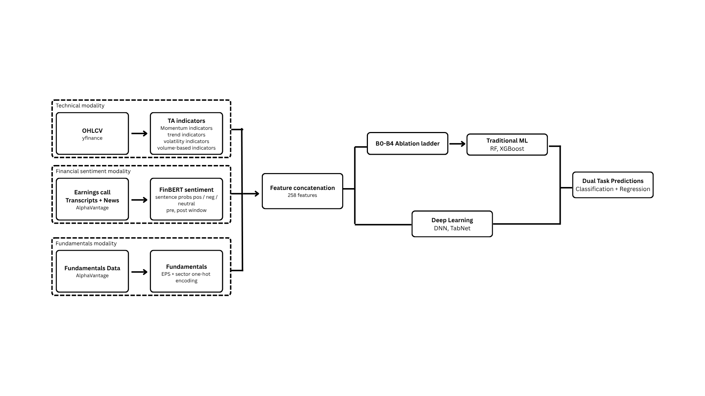

# Post-Earnings Forecast

Predict post-earnings-announcement drift (PEAD) for S&P 500 stocks: the target is the peak intraday high over the nine trading days (t+2…t+10) after each earnings event, predicted from technicals, fundamentals, sector, and FinBERT/news sentiment. ~24,000 events on ~500 constituents, evaluated on 20 expanding-window walk-forward folds (2021 Q1–2025 Q4).

**[Read the interactive report](https://richard-pears.dev/pead-report/)**



## Report (start here)

One self-contained Quarto walkthrough, end to end: EDA, models, and replayed trading strategy with 27 live Plotly charts:

```bash
export PATH="$HOME/.local/quarto/bin:$PATH"   # Quarto CLI 1.6.42
export QUARTO_PYTHON="$PWD/.venv/bin/python"
quarto render src/report/report.qmd --to html --output-dir "$PWD/src/out"
# open src/out/report.html
```

Renders offline from vendored data (`src/report/data/`, ~46MB). No S3, keys, or GPU.

Serve the prebuilt HTML anywhere:

```bash
docker build -f Dockerfile.report -t pead-report .
docker run --rm -p 8080:80 pead-report   # http://localhost:8080
```

Push to `main` renders in CI and ships `ghcr.io/richard-x46/post-earnings-forecast:latest` (`.github/workflows/docker-publish.yml`); the VPS serves it at the URL above via Caddy (`docker-compose.report.yml`).

## Results

Directional Accuracy (DA) = 3-class hit rate on the held-out quarter. Classes: low (<2%) / moderate (2–4%) / strong (≥4%) peak return. Majority-class baseline: 0.332.

| Model | Mean DA | Mean MAE | Mean RMSE | Best fold | Worst fold | Test rows |
|---|---|---|---|---|---|---|
| TabNet (initial) | 0.4371 | 0.0313 | 0.0476 | 0.702 (2022 Q4) | 0.299 (2024 Q2) | 9,937 |
| TabNet (updated) | 0.4495 | 0.0303 | 0.0446 | 0.690 (2022 Q4) | 0.335 (2025 Q1) | 9,937 |
| Multitask DNN | 0.4573 | 0.0296 | 0.0428 | 0.700 (2022 Q4) | 0.359 (2024 Q1) | 7,967 |

Strategy (TabNet signals, long classes 1–2 at t+1 close, exit at take-profit or t+10; $50k, $200/trade, no costs): Strat-1 at T=2% nets **+$6,637** (8,221 trades, 75.9% win, Sharpe 2.04, MaxDD −4.45%); Sharpe-selected T=5% nets **+$12,138** (Sharpe 2.33), profitable every full year. DNN T=5%: +$7,774 (Sharpe 1.77).

Caveats: zero transaction costs/slippage; threshold picked on its evaluation sweep; no SPY benchmark or bootstrap CIs yet. Details in the report (§9) and `docs/strat file implementation.md`.

## Project structure

```
├── src/
│   ├── report/          # Quarto report (report.qmd) + vendored data subset
│   ├── out/             # rendered report.html (gitignored build output)
│   ├── ingestion/       # S3 Delta Lake backfills (earnings, OHLCV, transcripts, VIX/SPX)
│   ├── preprocessing/   # technical features, FinBERT, sentiment staging, strat table
│   ├── modeling/        # TabNet (Modal GPU), multitask DNN, B1–B4 ablations, outputs
│   └── notebooks/       # EDA_final.ipynb
├── Dockerfile.report    # static nginx server for the prebuilt HTML
└── pyproject.toml       # deps, requires-python>=3.12 (managed with uv)
```

## Full pipeline (needs keys + GPU)

```bash
uv sync
cp .env.example .env   # AWS + Alpha Vantage + HuggingFace keys (region ca-central-1)
```

| Step | Commands |
|---|---|
| Ingestion (S3) | `backfill_earnings.py` → `backfill_ohvlc.py` → `backfill_transcripts.py` → `index_data.py` (all under `src/ingestion/`) |
| Engineering + sentiment | `technical_features.py` → `bert_earnings_call.py` → `bert_compaction_tx.py` → `sentiment_stg.py` → `strat_table.py` (all under `src/preprocessing/`) |
| TabNet (Modal T4, 20 folds) | `upload_model_data.py` → `modal run src/modeling/tabnet/modal_tabnet_pead.py` → `fetch_modal_results.py` |
| DNN / ablations / backtests | `multitask_dnn_updates.ipynb`, `b1-5/*.ipynb`, `TABNET_STRAT_4.ipynb`, `DNN_STRAT_4.ipynb` |

Key libraries: polars, scikit-learn, xgboost, torch + pytorch-tabnet, tensorflow, transformers (FinBERT), ta-lib (`brew install ta-lib` on macOS), deltalake + boto3, modal, optuna, plotly. Per-fold outputs (Parquet, histories, models) live under `src/modeling/model_outputs/`.
